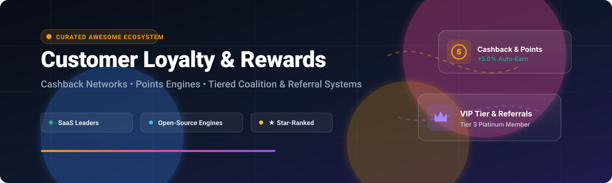

# Awesome Customer Loyalty & Rewards 

  

  <strong>Curated Directory of Customer Loyalty Software, Cashback Networks, Points Engines &amp; Self-Hosted Rewards Infrastructure</strong>

  <a href="#sector-overview--market-dynamics">Sector Overview</a> •
  <a href="#saas-hosted-platforms">SaaS Platforms</a> •
  <a href="#open-source-github-projects">Open-Source Engines</a> •
  <a href="#key-architectural-patterns">Architecture</a> •
  <a href="#how-to-contribute">Contribute</a>

---

## Overview & Scope

This repository tracks notable **SaaS platforms** and **open-source projects** for **Customer Loyalty & Rewards**. These solutions empower e-commerce merchants, retail brands, fintech ecosystems, and developers to incentivize repeat purchases, gamify retention, reward referrals, and build coalition programs—transforming transactional buyers into lifetime brand advocates through cashback, points ledgers, VIP tiers, and card-linked offers.

---

## Sector Overview & Market Dynamics

The global customer loyalty management market is estimated at **$6.47 billion in 2024 and is projected to reach $28.65 billion by 2032 (CAGR of ~20.4%)**, propelled by rising customer acquisition costs (CAC) and the shift toward first-party retention data. The sector exhibits **moderate-to-high fragmentation** across B2B merchant software (with hundreds of specialized apps, headless loyalty APIs, and e-commerce plugins competing on integration depth), contrasted with **extreme winner-take-all concentration** in consumer-facing coalition cashback networks (e.g., Rakuten, PayPal Honey, Ibotta) where two-sided network effects and bilateral retail affiliate contracts create virtually insurmountable competitive moats.

---

## Table of Contents

- [Sector Overview & Market Dynamics](#sector-overview--market-dynamics)
- [SaaS/Hosted Platforms](#saas-hosted-platforms)
- [Open-Source GitHub Projects](#open-source-github-projects)
- [Frameworks & Custom Systems](#frameworks-for-building-custom-systems)
- [How to Contribute](#how-to-contribute)
- [Disclaimer](#disclaimer)

---

## SaaS/Hosted Platforms

The table below catalogs premier hosted customer loyalty engines, consumer cashback platforms, and card-linked rewards providers, sorted descending by enterprise scale (company market valuation or reported annual revenue run-rate):

| Platform | Company Valuation / Revenue | Starting Pricing Tier | Free Tier Limits / Trial Period | Primary Architecture & Focus |
|:---|:---|:---|:---|:---|
| **[Shop Cash](https://shop.app/)** | **~$125.0B** *(Shopify Market Cap, 2026)* | **$39/month** *(Shopify Basic starting plan; Shop Cash fully funded by Shopify for 1% base earn)* | **3-day free trial** followed by $1/month promo for first 3 months; full admin & rewards access | Native consumer rewards in Shop app; merchants get automated 1% Shop Cash funded by Shopify with 0% extra fee |
| **[Honey Gold](https://www.joinhoney.com/)** | **~$70.0B** *(Parent PayPal Market Cap; Honey acquired for $4.0B)* | **Commission-based affiliate model** *(Merchant affiliate CPA/CPS starting at 3%–10% per sale)* | **100% Free forever for consumers**; free store directory listing for standard PayPal/Braintree merchants | Browser extension & checkout coupon finder with merchant-sponsored Gold points redeemable for gift cards |
| **[Rakuten Rewards](https://www.rakuten.com/)** | **~$14.5B** *(Parent Rakuten Group Market Cap; ~$15B+ Annual Revenue)* | **Affiliate CPA revenue share** *(Typically 1%–15% commission per tracked order depending on merchant vertical)* | **100% Free forever for consumers**; merchants pay zero upfront SaaS subscription fee (pure performance CPA) | Coalition cashback network partnering with 3,500+ merchants; quarterly cash payouts via PayPal or paper check |
| **[Swagbucks](https://www.swagbucks.com/)** | **~$1.5B** *(Parent Prodege Valuation; $200M+ Annual Revenue)* | **Performance-based CPA/CPL** *(Starting at $1.50 per validated user action or survey completion)* | **100% Free forever for consumers**; $10 welcome bonus; no subscription charge | Gamified rewards platform offering points (SB) for shopping, web searches, video viewing, and surveys |
| **[Ibotta](https://ibotta.com/)** | **~$1.4B** *(NYSE: IBTA Market Cap; ~$320M Annual Revenue)* | **Pay-per-sale affiliate performance fee** *(Starting at 2%–8% manufacturer/retailer rebate spend)* | **100% Free forever for consumers**; $20 minimum cash-out threshold via linked bank or gift cards | Item-level grocery & retail cashback engine with receipt scanning and direct card-linked loyalty account sync |
| **[Upside](https://www.upside.com/)** | **~$1.5B** *(Valued at $1.5B Series D; $150M+ ARR)* | **Profit-sharing performance pricing** *(Starting at ~15%–20% share of verified incremental merchant margin)* | **100% Free forever for consumers**; zero upfront or monthly merchant fee (charged only on proven margin lift) | Brick-and-mortar personalized cashback platform optimizing fuel, grocery, and restaurant customer dwell-time |
| **[Fetch Rewards](https://fetch.com/)** | **~$2.5B+** *(Private Valuation; $200M+ Revenue Run-Rate)* | **Brand partnership sponsor pricing** *(Starting at $10,000/campaign for CPG item promotions)* | **100% Free forever for consumers**; rewards unlock at 3,000 points (~$3 value); receipt scanning | Consumer receipt-scanning app converting paper & digital receipts into partner gift cards and gaming rewards |
| **[Drop](https://joindrop.com/)** | **~$350M** *(Total capital raised $100M+; $30M+ ARR)* | **Affiliate commission split** *(Starting at 3%–7% tracked order commission)* | **100% Free forever tier**; card-linked automated tracking on up to 5 merchant selections | Card-linked coalition program awarding points automatically on linked debit/credit cards |
| **[TopCashback](https://www.topcashback.com/)** | **~$150M** *(Privately held UK/US; $100M+ Revenue)* | **Merchant affiliate network rate** *(Commission pass-through with optional paid sponsored placements)* | **100% Free Classic account**; Plus membership optional at £5/$5 deducted annually from cashback earnings | Fair-play rebate network passing 100% of affiliate merchant commissions directly back to consumer members |
| **[Lolli](https://www.lolli.com/)** | **~$70M** *(Series B backed; $10M+ ARR)* | **Affiliate performance commission** *(Starting at 2%–12% order value split into Satoshis)* | **100% Free forever browser extension & mobile app**; card-linking available with no setup fees | Bitcoin cashback on-ramp awarding Satoshi fractions and cash back on shopping, booking travel, and gaming |

---

## Open-Source GitHub Projects

The following self-hosted customer loyalty backends, points management plugins, and rewards applications are ranked descending by GitHub Stargazers:

| Repository & Stars | Technology Stack | Primary Architecture & Capabilities | License |
|:---|:---|:---|:---|
| **[CatimaLoyalty/Android](https://github.com/CatimaLoyalty/Android)**  | Java / Kotlin / Android SDK | **1,730+ Stars** • Full privacy-first digital loyalty card and ticket wallet. Replaces plastic barcode cards, supports offline storage, card grouping, notes, OCR scanning, and export/import. | GPL-3.0 |
| **[l4rm4nd/VoucherVault](https://github.com/l4rm4nd/VoucherVault)**  | Python / Django / SQLite / PWA | **513+ Stars** • Self-hosted web app to digitize and manage coupons, loyalty vouchers, and gift cards. Features offline PWA caching, expiration alerts, balance histories, and OIDC SSO. | AGPL-3.0 |
| **[amicalhq/refref](https://github.com/amicalhq/refref)**  | TypeScript / Next.js / Supabase / PostgreSQL | **239+ Stars** • Developer-centric open-source referral and affiliate reward engine. Tracks referral conversions, generates discount codes, and manages multi-tier advocate rewards. | MIT |
| **[Raktim94/nodedr-restaurant-pos](https://github.com/Raktim94/nodedr-restaurant-pos)**  | Node.js / Express / MongoDB / React | **224+ Stars** • Self-hosted restaurant management & POS with integrated customer loyalty tiers, table reservations, QR ordering, and automated point accrual upon checkout. | MIT |
| **[brarcher/loyalty-card-locker](https://github.com/brarcher/loyalty-card-locker)**  | Java / Android | **177+ Stars** • Lightweight open-source Android barcode locker for store loyalty and membership cards with camera-based barcode scanning and fast POS retrieval. | GPL-3.0 |
| **[amazon-archives/aws-serverless-appsync-loyalty](https://github.com/amazon-archives/aws-serverless-appsync-loyalty)**  | AWS Lambda / AppSync / GraphQL / DynamoDB | **116+ Stars** • Enterprise serverless customer loyalty sample application illustrating event-driven transaction accrual, real-time GraphQL point balances, and scalable redemption. | Apache-2.0 |
| **[IBM/customer-loyalty-program-hyperledger-fabric-VSCode](https://github.com/IBM/customer-loyalty-program-hyperledger-fabric-VSCode)**  | Hyperledger Fabric / Node.js / Vue.js | **106+ Stars** • Distributed ledger coalition loyalty program where multiple partners track member points, prevent double-spending, and execute secure token redemptions. | Apache-2.0 |
| **[miracuthbert/laravel-royalty](https://github.com/miracuthbert/laravel-royalty)**  | PHP / Laravel | **82+ Stars** • Pluggable Laravel package for customer reward points, gamification XP, loyalty balances, and transactional ledger events with real-time broadcasting. | MIT |
| **[OpenLoyalty/loyalty-blockchain](https://github.com/OpenLoyalty/loyalty-blockchain)**  | Go / Hyperledger Fabric | **35+ Stars** • Enterprise blockchain API module for loyalty assets: points ledgers, digital vouchers, gift card verification, and cryptographic multi-partner settlement. | MIT |
| **[vinsol-spree-contrib/spree-loyalty-points](https://github.com/vinsol-spree-contrib/spree-loyalty-points)**  | Ruby / Rails / Spree Commerce | **25+ Stars** • Extension for Spree e-commerce stores allowing users to earn loyalty points on orders and spend them as partial or full payment during checkout. | BSD-3-Clause |
| **[wpswings/points-and-rewards-for-woocommerce](https://github.com/wpswings/points-and-rewards-for-woocommerce)**  | PHP / WordPress / WooCommerce | **15+ Stars** • Complete WooCommerce points & rewards plugin: earns points on registration, purchases, and social referrals; cart checkout redemption; badges and spin-the-wheel. | GPL-2.0 |
| **[PrestaShop/loyalty](https://github.com/PrestaShop/loyalty)**  | PHP / PrestaShop | **13+ Stars** • Native loyalty program module for PrestaShop stores offering points-to-voucher conversions and discount coupons for repeat customer checkouts. | AFL-3.0 |
| **[R3v180/LoyalPyME](https://github.com/R3v180/LoyalPyME)**  | Node.js / React / PostgreSQL | **5+ Stars** • Integrated SME loyalty management and POS system featuring customer tier calculations, redemption catalog, digital menu ordering, and kitchen display. | MIT |
| **[abarlow4944/Premio](https://github.com/abarlow4944/Premio)**  | React / Vite / Tailwind / Node / Prisma | **1+ Star** • Full-stack loyalty application with cashier/manager roles, QR code customer scanning, peer-to-peer point transfers, RSVP rewards, and Recharts analytics. | MIT |
| **[AlAfiz/tapestry](https://github.com/AlAfiz/tapestry)**  | Rust / Stellar Soroban smart contracts | **0 Stars** • Coalition loyalty protocol on Stellar Soroban with per-merchant SEP-41 tokens, on-chain cross-merchant conversion rates, and settlement netting. | Apache-2.0 |

---

## Frameworks for Building Custom Systems

When evaluating the open-source landscape for loyalty, retention, and points mechanics, select based on architecture:

1. **WordPress / WooCommerce Ecosystem**: Deploy [Points and Rewards for WooCommerce](https://github.com/wpswings/points-and-rewards-for-woocommerce) for turn-key store credits, referral tiers, and gamified redemption.
2. **Laravel & PHP Backends**: Use [laravel-royalty](https://github.com/miracuthbert/laravel-royalty) to inject transactional double-entry points ledgers and reward levels into custom applications.
3. **Ruby on Rails / Spree**: Implement [spree-loyalty-points](https://github.com/vinsol-spree-contrib/spree-loyalty-points) for native checkout points conversion.
4. **Cloud-Native Serverless**: Follow the AWS reference pattern [aws-serverless-appsync-loyalty](https://github.com/amazon-archives/aws-serverless-appsync-loyalty) with DynamoDB transactions and GraphQL subscriptions.
5. **Coalition / Multi-Partner Ledgers**: Deploy [IBM Hyperledger Fabric](https://github.com/IBM/customer-loyalty-program-hyperledger-fabric-VSCode) or [Stellar Soroban Tapestry](https://github.com/AlAfiz/tapestry) to facilitate cross-brand token redemption without centralized escrow risk.

---

## How to Contribute

1. Fork the repository.
2. Add or update entries following standard table markdown formatting.
3. Keep descriptions objective, verify star counts, and link directly to official documentation or source code.
4. Submit a Pull Request detailing your changes.

---

## Disclaimer

- This is a community-curated directory intended for software evaluation and engineering research.
- Customer loyalty programs handling financial rebates, rewards points, and user purchase metadata are subject to regional consumer protection rules, privacy laws (GDPR, CCPA), and escheatment laws regarding unclaimed property / expiring points.
- Open-source software provides full control over data ownership and infrastructure; however, consumer coalition cashback models (e.g. Rakuten, Ibotta) require affiliate retailer partnership networks that open-source software cannot supply out-of-the-box.
